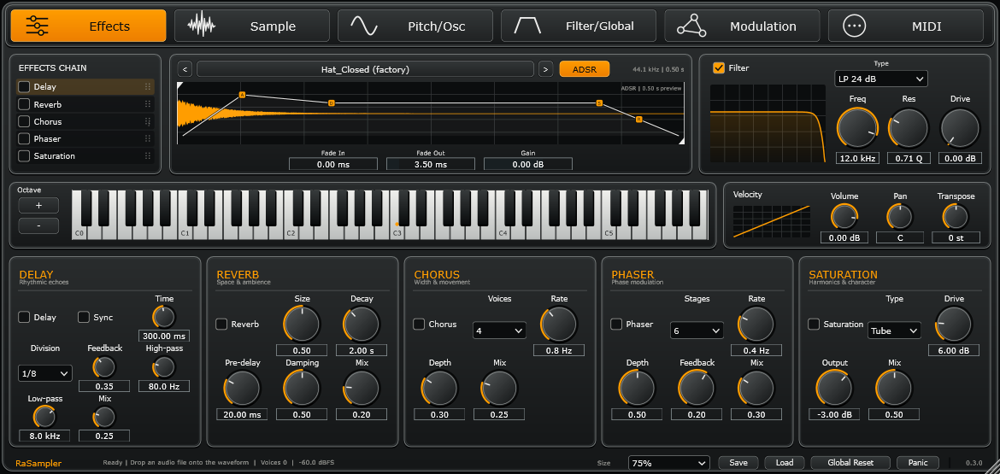

# RaSampler

Windows x64 VST3 sampler instrument, by Voyagersquare. Native C++17 / JUCE 8.0.6.

Jedan učitani sample, šest kartica, bez zona. Tamno metalno sučelje s narančastim kontrolama prema dogovorenim referentnim slikama. Svi gumbi i parametri donjih panela povezani su s instrumentom.



Prikaz nove ADSR ovojnice s primjerom postavki Attack 60 ms, Decay 90 ms, Sustain 0.8 i Release 80 ms. Početne zvučne postavke instrumenta ostaju iste.

[Pregled svih šest kartica](docs/screenshots/) · [Novi LOOP markeri](docs/screenshots/Loop.png)

## Preuzimanje i instalacija

GitHub → **Actions → Build and verify RaSampler → zadnji uspješni run → RaSampler-Windows-x64**. Raspakirajte cijeli ZIP. Pokrenite `Install-Windows.ps1` u PowerShellu ili kopirajte cijelu mapu `RaSampler.vst3` u `C:\Program Files\Common Files\VST3` (zahtijeva administratorska prava). Ponovno skenirajte VST3 instrumente u DAW-u. `RaSampler.exe` je samostalna aplikacija; postavke zvučne kartice/MIDI-ja nalaze se u njezinu Options izborniku. U paketu su i slike svih šest kartica.

## Rad

Prozor se otvara na **75% (1170 × 555 px)**. Izbornik **Size** u donjoj traci nudi 60%, 75%, 90%, 100%, 125% i 150%. Veličinu možete mijenjati i povlačenjem donjeg desnog kuta, uz očuvanje proporcija. Nove instance i ponovno otvoreni editor počinju na 75%.

- Klik na naziv datoteke ili drag-and-drop učitava WAV, AIFF, FLAC, OGG ili MP3. Strelice pretražuju audio datoteke u istoj mapi. Maksimum je 128 MB i 10 minuta.
- Jedan sample svira preko klavijature; **Root Note** je izvorna visina. Narančasta točka označava root, narančasta tipka pritisnutu notu. Nazivi nota koriste C3 za MIDI 60.
- Start, End, Loop, Reverse i Snap nalaze se na donjoj kartici **Sample**, bez duplikata u gornjem redu. Fade In, Fade Out i Gain ostaju dostupni uz waveform.
- Granice Start/End i Loop Start/End prikazane su u sampleovima. Povucite bijele markere za Start/End; Tirkizni LOOP IN / LOOP OUT markeri imaju debele linije i velike označene ručke; povucite ručku izravno ili koristite Shift-povlačenje u waveformu. Kratke petlje dobivaju dvije odvojene razine oznaka radi lakšeg odabira. Snap poravnava na lokalni tranzijent.
- **ADSR na waveformu:** gumb ADSR uz naziv datoteke prikazuje bijelu amplitudnu ovojnicu s narančastim točkama A, D, S i R. A se povlači vodoravno za Attack; D vodoravno za Decay i okomito za Sustain; S okomito za Sustain; R (sredina silazne linije) vodoravno za Release — ulijevo za dulji release. Kontrole su povezane s amplitudnim ADSR-om na Filter/Global. Prikaz automatski prilagođava raspon da sve faze ostanu vidljive; navedeno trajanje je pregled ovojnice, ne položaj MIDI Note Off u sampleu. Vrlo kratke faze imaju minimalni vizualni razmak radi odabira. Shift-povlačenje i dalje uređuje petlju. Skriveni prikaz ne isključuje zvučnu ovojnicu. Parametri i vidljivost spremaju se s projektom/presetom.
- Gate slijedi Note Off i ADSR. One-shot svira do završetka uzorka; uz uključen Loop svira do Panic/All Notes Off. Petlja koristi zasebne granice. Fade In/Out odnose se na rubove izrezanog uzorka.
- Effects otvara svih pet panela istovremeno. Kvačice uključuju efekte. Povucite ručku desno od naziva u Effects Chainu da promijenite redoslijed. Ploče efekata ostaju na stalnim mjestima.
- Pitch/Osc ima transpose, detune, pitch ADSR, dodatni oscilator i vremensku obradu. Oscilator dijeli amplitudnu ovojnicu i filter sa sampleom.
- **Time-stretch** radi offline WSOLA obradom u pozadinskoj niti, čuva visinu pri promjeni trajanja od 0.25× do 4× (najdulji obrađeni uzorak: 10 minuta). Nove note koriste obrađeni sample kad obrada završi; već pokrenuti glasovi završavaju sa svojom verzijom. To nije sustav beat/warp markera. Standardno MIDI transponiranje mijenja brzinu i trajanje reprodukcije.
- Filter je po glasu, prije efekata. LP/HP 12 i 24 dB, BP, Notch i PEQ. Resonance je Q; EQ Gain upravlja PEQ pojačanjem. Global Volume/Pan djeluju prije FX lanca. Gain uz sample podešava samo sample prije zbrajanja s oscilatorom.
- Modulation: 2 LFO-a, filterska ovojnica i 8 modulacijskih veza. Amp/Pitch ovojnice uređuju se na njihovim karticama. Sync koristi tempo DAW-a (120 BPM bez host tempa).
- MIDI: kanal, velocity krivulja, pitch bend, aftertouch, sustain i CC Learn. Za CC Learn odaberite parametar, kliknite Learn CC i pomaknite kontroler. Mapiranje parametra primjenjuje se preko message threada; nije namijenjeno audio-rate modulaciji. Standardni host automation dostupan je za parametre.
- Save/Load sprema `.rasampler` preset, uključujući izvorni audio. DAW state također ugrađuje audio, postavke i MIDI mapiranja. Vanjska datoteka nije potrebna pri ponovnom otvaranju projekta. **Global Reset** u donjoj traci vraća sve zvučne parametre i redoslijed efekata na tvorničke vrijednosti, briše MIDI mapiranja, zaustavlja glasove i repove efekata te vraća izvorno trajanje uzorka. Učitani sample i odabrana veličina prozora ostaju sačuvani. Panic prekida glasove i čisti repove efekata.

## Izgradnja

Windows: Visual Studio 2022, workload **Desktop development with C++**, CMake 3.22+, Git.

```powershell
cmake -S . -B build -A x64
cmake --build build --config Release --parallel 2
build/RaSamplerCheck_artefacts/Release/RaSamplerCheck.exe --self-test
build/RaSamplerCheck_artefacts/Release/RaSamplerCheck.exe --screenshots build/screenshots
```

CMake preuzima JUCE s fiksnog commita. Gotovi plugin: `build/RaSampler_artefacts/Release/VST3/RaSampler.vst3`. Izgradnja na Linuxu također je podržana za provjeru; potrebni su standardni JUCE X11, ALSA i font development paketi.

## Provjera i granice verzije

`RaSamplerCheck --self-test` provjerava audio izlaz, točan MIDI offset, Panic, reverse petlju, oscilator, filtere/efekte, redoslijed efekata, state restore, WSOLA trajanje, ugrađivanje audio datoteke i Note Off. `--screenshots <mapa>` renderira stvarni native editor za svih šest kartica.

Ovo je početna verzija 0.3.0. Parametri Reverba Size i Decay zajedno se preslikavaju na JUCE reverb; Decay nije kalibrirano RT60 mjerenje. Saturation i square/saw oscilatori nemaju oversampling/antialiasing. WSOLA može dati artefakte na velikim omjerima ili složenim uzorcima. Nema crossfadea petlje; za diskontinuitet na spoju trebaju odgovarajuće granice. Potrebna je dodatna provjera u stvarnim Windows DAW-ovima prije produkcijske uporabe.

Vidi `THIRD_PARTY.md` za uvjete JUCE licence prije distribucije.
